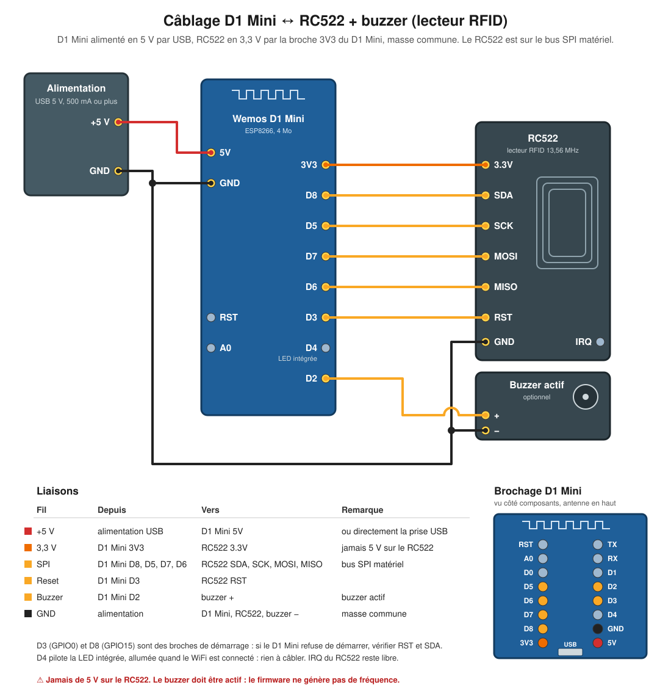

# Lecteur RFID WiFi (ESP8266 D1 Mini + RC522)

Firmware PlatformIO pour un lecteur de badges RFID/NFC autonome, construit autour d'un **Wemos D1 Mini (ESP8266)** et d'un **module RC522 (13,56 MHz)**. À chaque badge présenté, l'UID est envoyé en `POST` à une URL de votre choix (Home Assistant, Node-RED, script maison...), avec un retour sonore selon la réponse. Tout se règle depuis une interface web embarquée, sans recompiler.


## Points forts

- **Envoi de l'UID à une API** : `POST uid=<uid>` vers l'URL configurée, en HTTP ou HTTPS. Les 32 derniers envois sont visibles dans l'onglet *Terminal API*.
- **Retour sonore** : bip à la détection, puis un bip long si l'API répond `200`, cinq bips courts sinon.
- **Premier démarrage sans câble ni recompilation** : sans WiFi configuré, le lecteur ouvre son propre point d'accès avec portail captif pour saisir le réseau.
- **Interface web protégée par un code** : état du système, dernier badge lu, réglages WiFi et API, délai entre scans, test du buzzer, mise à jour du firmware.
- **Mises à jour sans fil**, par ArduinoOTA (PlatformIO) ou en envoyant un `.bin` depuis l'interface web.
- **Lecture du contenu des badges** (désactivable) : MIFARE Classic 1K/4K avec la clé par défaut, MIFARE Ultralight.
- **Réglages conservés** en flash (EEPROM émulée) : URL de l'API, WiFi, délai entre scans, code d'accès, lecture mémoire.

## Câblage

Le D1 Mini est alimenté en **5 V** par son port USB et fournit le **3,3 V** du RC522 par sa broche 3V3, avec une **masse commune**. Le RC522 est relié au bus SPI matériel. Le buzzer est optionnel.



(version PNG : [`docs/schema-cablage-d1mini-rc522.png`](docs/schema-cablage-d1mini-rc522.png))

| D1 Mini | Relié à | Remarque |
|---|---|---|
| 3V3 | RC522 3.3V | **Jamais 5 V** sur le RC522 |
| GND | RC522 GND, buzzer − | Masse commune |
| D8 (GPIO15) | RC522 SDA (SS) | |
| D5 (GPIO14) | RC522 SCK | SPI matériel |
| D7 (GPIO13) | RC522 MOSI | SPI matériel |
| D6 (GPIO12) | RC522 MISO | SPI matériel |
| D3 (GPIO0) | RC522 RST | |
| D2 (GPIO4) | buzzer actif + | Optionnel |
| D4 (GPIO2) | LED intégrée | Rien à câbler |
| — | RC522 IRQ | Non connecté |

Les broches se changent dans [`include/config.h`](include/config.h).

Conseils :

- D3 (GPIO0) et D8 (GPIO15) sont des broches de démarrage de l'ESP8266 : GPIO0 doit être à l'état haut et GPIO15 à l'état bas au démarrage. Avec un RC522 standard cela ne pose pas de problème, mais si le D1 Mini refuse de démarrer quand le module est branché, vérifiez d'abord le câblage de RST et SDA.
- Un **buzzer actif** (qui sonne dès qu'il est alimenté) est nécessaire : un buzzer passif resterait muet, le firmware ne génère pas de fréquence.
- La portée est de 2 à 3 cm : présentez le badge à plat, au centre de l'antenne. Éloignez l'antenne de toute surface métallique.

## Installation

### 1. Les réglages de compilation

Dans [`include/config.h`](include/config.h), changez au moins les mots de passe par défaut :

```c
#define OTA_PASSWORD "password123"   // mot de passe des mises à jour ArduinoOTA
#define HOSTNAME     "RFID-SCANNER"  // nom réseau (mDNS : rfid-scanner.local)
#define AP_SSID      "RFID-Config"   // point d'accès de configuration
#define AP_PASS      "12345678"      // son mot de passe (8 caractères minimum)
```

Si vous changez `OTA_PASSWORD` ou `HOSTNAME`, reportez-les dans l'environnement `d1_mini_ota` de [`platformio.ini`](platformio.ini) (`--auth=` et `upload_port`).

Le WiFi, l'URL de l'API et le code d'accès web ne sont **pas** dans le code : ils se règlent depuis l'interface web et restent en flash.

### 2. Compiler et flasher

Avec [PlatformIO](https://platformio.org/) (extension VS Code ou en ligne de commande) :

- **Première fois, au câble** :
  ```sh
  pio run -e d1_mini_usb -t upload
  pio device monitor        # 115200 bauds
  ```
- **Ensuite, sans fil** (même réseau que le lecteur) :
  ```sh
  pio run -e d1_mini_ota -t upload
  ```
- **Ou depuis l'interface web** : onglet *Configuration* → *Mise à jour du firmware*, avec le fichier `.pio/build/d1_mini_usb/firmware.bin`.

### 3. Premier démarrage

1. Sans WiFi enregistré (ou si la connexion échoue pendant 20 s), le lecteur ouvre le point d'accès **`RFID-Config`** (mot de passe `12345678`).
2. Connectez-vous-y avec un téléphone : le portail captif s'ouvre, sinon allez sur `http://192.168.4.1`.
3. Entrez le code d'accès (par défaut **`admin`**).
4. Onglet *Configuration* : scannez les réseaux, choisissez le vôtre, saisissez le mot de passe, enregistrez, puis *Redémarrer*.
5. Le lecteur rejoint votre réseau et la LED s'allume. L'interface est alors sur `http://rfid-scanner.local` ou sur l'adresse IP affichée dans le moniteur série.
6. Renseignez l'**URL de l'API** et **changez le code d'accès**.

## L'interface web

| Onglet | Contenu |
|---|---|
| État | Mode, mémoire libre, temps de fonctionnement, signal WiFi, dernier badge lu |
| RFID | Lecture / arrêt / infos, écriture d'un texte, lecture mémoire activée ou non, délai entre deux scans (500 ms minimum, 3 s par défaut) |
| Configuration | URL de l'API, WiFi, test du buzzer, redémarrage, mise à jour du firmware, code d'accès |
| Terminal API | Les 32 derniers envois : heure (depuis le démarrage), UID, code HTTP, URL |

## L'envoi à l'API

À chaque badge en mode lecture, le lecteur envoie :

```http
POST <URL configurée>
Content-Type: application/x-www-form-urlencoded

uid=a1b2c3d4
```

L'UID est en hexadécimal minuscule, sans séparateur. En HTTPS, le certificat du serveur n'est pas vérifié.

| Résultat | Code journalisé | Bips |
|---|---|---|
| Réponse `200` | 200 | 2 courts à la détection, puis 1 long |
| Autre réponse HTTP | le code reçu | 2 courts, puis 5 très courts |
| WiFi absent ou URL invalide | -1 | 2 courts, puis 5 très courts |
| Échec de connexion | -2 ou code d'erreur négatif | 2 courts, puis 5 très courts |

Exemple côté Home Assistant, avec un webhook :

```yaml
automation:
  - alias: Badge RFID présenté
    triggers:
      - trigger: webhook
        webhook_id: badge-rfid
        allowed_methods: [POST]
        local_only: true
    actions:
      - action: notify.notify
        data:
          message: "Badge {{ trigger.data.uid }}"
```

URL à saisir dans le lecteur : `http://<ip-home-assistant>:8123/api/webhook/badge-rfid`.

## Routes HTTP

| Route | Méthode | Rôle |
|---|---|---|
| `/` | GET, POST | Interface web (paramètre `code`) |
| `/api/status` | GET | JSON : `mode`, `memory`, `uptime`, `rssi` |
| `/api/lastcard` | GET | Dernier badge lu (HTML) |
| `/api/command?cmd=READ\|STOP\|INFO` | GET | Change le mode |
| `/api/write?data=...` | GET | Passe en mode écriture avec ce texte |
| `/api/apiurl`, `/api/setapiurl?url=...` | GET | Lit ou change l'URL de l'API |
| `/api/wificonfig`, `/api/setwificonfig` | GET, POST | Lit ou change le WiFi (`ssid`, `pass`) |
| `/api/wifiscan` | GET | Réseaux WiFi visibles |
| `/api/scandelay` | GET, POST | Délai entre scans en ms (`delay`) |
| `/api/readmemory` | GET, POST | Lecture mémoire (`enabled=1\|0`) |
| `/api/webcode` | GET, POST | Code d'accès web (`code`) |
| `/api/buzzer?times=..&duration=..` | GET | Test du buzzer |
| `/api/apilog` | GET | Historique des envois (JSON) |
| `/update` | POST | Envoi d'un firmware `.bin` |
| `/restart` | GET | Redémarrage |

> **Attention** : seule la page `/` demande le code d'accès. Les routes `/api/*`, `/update` et `/restart` sont ouvertes à tout appareil du réseau, y compris `/api/wificonfig` et `/api/webcode` qui renvoient le mot de passe WiFi et le code d'accès. Réservez le lecteur à un réseau de confiance (VLAN IoT par exemple).

## Commandes série

Au moniteur série (115200 bauds), insensibles à la casse :

| Commande | Effet |
|---|---|
| `READ` | Mode lecture (par défaut) |
| `WRITE <texte>` | Écrit jusqu'à 16 caractères dans le bloc 4 (secteur 1) du prochain badge |
| `SCAN` / `STOP` | Reprend / suspend la détection |
| `INFO` | Brochage, mode, mémoire libre, WiFi, OTA |
| `FORMAT` | Remet à zéro les blocs de données des secteurs 1 à 15 du prochain badge |
| `BACKUP` | Affiche le contenu complet du prochain badge |
| `WIFI` | Relance la connexion WiFi |
| `OTA` | Active ArduinoOTA (déjà actif si le WiFi est connecté au démarrage) |

Exemple de sortie à la lecture d'un badge :

```
=== Carte détectée ===
UID:  A1 B2 C3 D4
Type: MIFARE 1KB
--- Lecture complète de la carte ---
Secteur 1:
  Bloc 4 | Clé utilisée: FFFFFFFFFFFF |  48 65 6C 6C 6F 00 ... | Hello...
...
[API] Préparation envoi UID: a1b2c3d4 vers http://192.168.1.10:8123/api/webhook/badge-rfid
[API] Code HTTP: 200
===================
```

## Badges pris en charge

| Type | UID | Contenu |
|---|---|---|
| MIFARE Classic 1K / 4K / Mini | Oui | Secteurs 1 à 15, clé A par défaut (`FF FF FF FF FF FF`) |
| MIFARE Ultralight / NTAG | Oui | Pages 0 à 15 |
| Autres ISO 14443-A | Oui | Non |

L'interface web n'affiche que les 2 premiers secteurs (ou 4 premières pages) ; le reste est sur le port série. Si la lecture du contenu ne vous sert pas, désactivez-la dans l'onglet *RFID* : l'UID part plus vite.

## Dépannage

| Symptôme | Piste |
|---|---|
| `Firmware Version: 0x0` ou `0xFF` au démarrage | Pas de dialogue SPI avec le RC522 : vérifiez le câblage et l'alimentation 3,3 V |
| `Auth échouée: Timeout` | Câblage SPI, alimentation, ou badge trop loin |
| `Auth échouée` sans timeout | Le badge n'utilise pas la clé par défaut : seul l'UID est fiable |
| Le lecteur repasse en point d'accès `RFID-Config` | Connexion WiFi impossible en 20 s : mot de passe, portée, ou réseau 5 GHz (l'ESP8266 ne gère que le 2,4 GHz) |
| `rfid-scanner.local` ne répond pas | mDNS bloqué sur le réseau : utilisez l'adresse IP |
| Code `-1` dans le terminal API | WiFi déconnecté ou URL ne commençant pas par `http` |

## Fichiers

| Fichier | Rôle |
|---|---|
| [`src/main.cpp`](src/main.cpp) | Tout le firmware : RFID, WiFi, serveur web, API, OTA, EEPROM |
| [`include/config.h`](include/config.h) | Broches, nom réseau, mots de passe OTA et point d'accès, plan EEPROM |
| [`include/webpage.h`](include/webpage.h) | Interface web (HTML/CSS/JS embarqués) |
| [`include/login_page.h`](include/login_page.h) | Page de saisie du code d'accès |
| [`platformio.ini`](platformio.ini) | Environnements `d1_mini_usb` et `d1_mini_ota` |

## Licence

GPL-3.0, voir [LICENSE](LICENSE).
